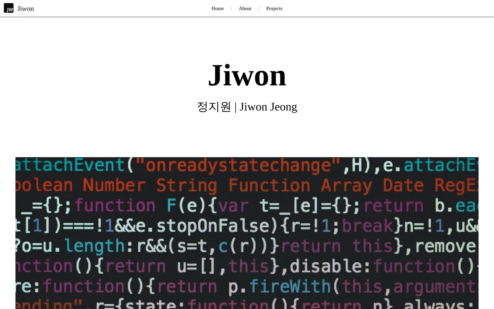

# 🌐 Wondev Website

**정지원의 자기소개 · 프로젝트 소개 웹사이트 (2023)**

[**사이트 보기 →**](https://jiwonsudo.github.io/Wondev-Website/)

## 구성

| 페이지 | 내용 |
|---|---|
| Home | 인트로 · 좋아하는 문장 · 연락처 |
| About | 소개 · 이력 |
| Projects | MaeChat, QRAZY 등 프로젝트 소개 |

> 현재 포트폴리오는 [jiwonsudo.github.io/portfolio](https://jiwonsudo.github.io/portfolio/)에서 볼 수 있습니다.
